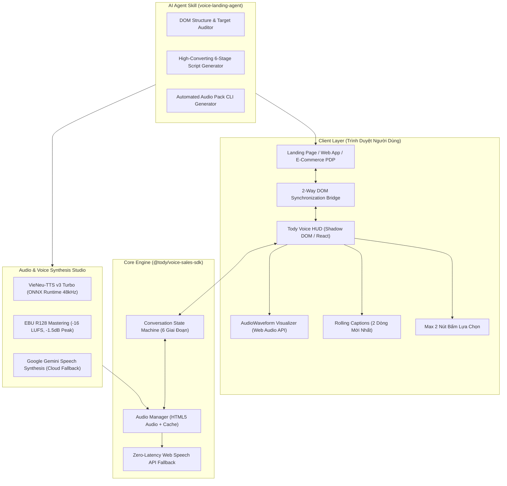
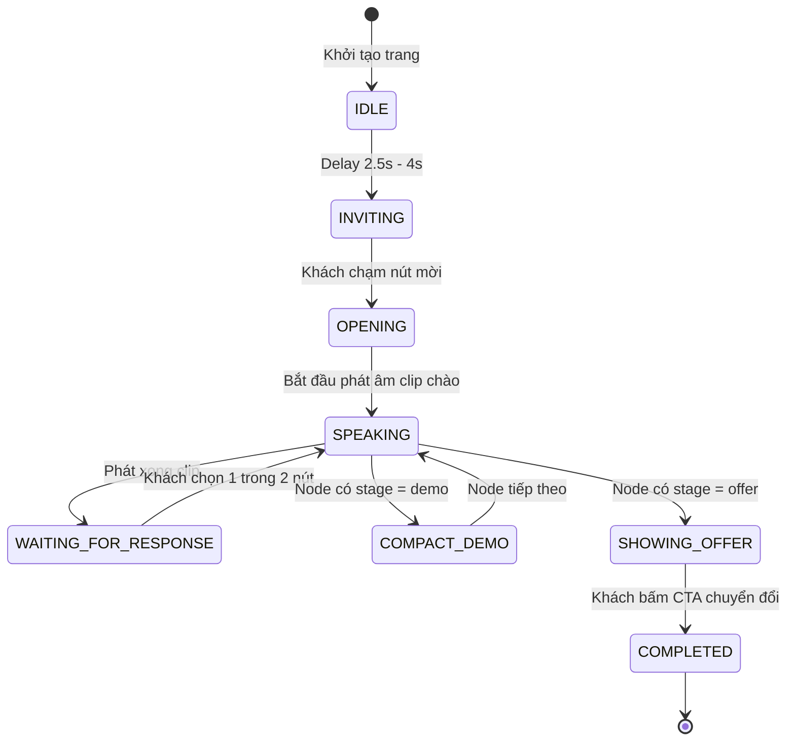

# Kiến Trúc Hệ Thống Tody Voice Agent (System Architecture)

**Tody Voice Agent** là một nền tảng chuyển đổi số chuyên sâu (Conversion Rate Optimization - CRO) kết hợp giữa **Trợ lý Bán hàng bằng Giọng nói AI** và **Màn hình Trình diễn Tương tác 2 Chiều (Interactive Sandbox)**. Hệ thống được thiết kế để triển khai đồng nhất trên đa nền tảng và hàng loạt dự án khác nhau (SaaS, E-commerce PDP, B2B Landing Pages, EdTech).

---

## 1. Sơ Đồ Khối Tổng Thể (High-Level Topology)

---

## 2. 6 Quy Chuẩn Bất Biến Về Trải Nghiệm (Conversion UX Invariants)

Hệ thống bắt buộc tuân thủ 6 nguyên tắc vàng đã được kiểm chứng qua hàng triệu phiên người dùng:

1. **Khung HUD 85% Viewport Width (`85vw max-w-4xl`)**:
   - Khung tư vấn neo ở đáy màn hình chính giữa, chiếm `85vw` để dàn trải 2 nút lựa chọn theo chiều ngang. Người dùng nhìn thấy ngay cả lời nói và 2 lựa chọn mà không cần phải cuộn chuột.
2. **Ẩn Mascot/Avatar Khi Đang Tư Vấn/Phát Âm**:
   - Mascot chỉ xuất hiện ở nút nổi góc phải khi rảnh rỗi. Khi bắt đầu tư vấn, mascot được ẩn hoàn toàn để nhường không gian cho phụ đề và thanh sóng âm `AudioWaveform` 5 cột tinh gọn.
3. **Phụ Đề Trôi Đi Tối Đa 2 Dòng ("2-Line Rolling Captions")**:
   - Tuyệt đối không giữ lịch sử chat dài dạng cuộn gây rối mắt. Chỉ hiển thị duy nhất câu thoại mới nhất được kẹp trong 2 dòng (`line-clamp-2`), trôi nhẹ từ dưới lên theo nhịp thở giọng nói.
4. **Tuyệt Đối Tối Đa 2 Nút Bấm Mỗi Bước (Strictly Max 2 Buttons)**:
   - Mỗi câu thoại chỉ đưa ra đúng 2 hướng đi: **1 Nút Chính** (Nổi bật, độ tương phản cao cho hành vi tiến bước) + **1 Nút Phụ** (Viền mảnh, màu dịu cho phương án phụ hoặc nghe lại). Triệt tiêu 100% hiện tượng do dự (Analysis Paralysis).
5. **Không Cần Xin Quyền Micro (Listen & Choose Model)**:
   - Không yêu cầu quyền microphone trình duyệt (`getUserMedia`). Trợ lý nói bằng giọng tự nhiên và khách chỉ cần chạm nút chọn ngay tức thì. Loại bỏ hoàn toàn rào cản tâm lý e ngại bị nghe lén.
6. **Đồng Bộ Hai Chiều Với Màn Hình Demo (Two-Way Sync & Compact HUD)**:
   - Khi bước vào giai đoạn Demo (`stage: 'demo'`), khung tư vấn tự động co nhỏ về góc phải màn hình (`sm:w-[388px]`) và phát sự kiện `voice:action` (`scrollToSection`, `openDemoScene`, `highlightArea`, `pulseCTA`) để cuộn trang và đổi cảnh demo theo thời gian thực.

---

## 3. Máy Trạng Thái Hội Thoại 6 Giai Đoạn (Conversation State Machine)

---

## 4. Chuẩn Chuẩn Hóa Âm Thanh Studio (Acoustic Mastering Pipeline)

- **Engine Cốt Lõi**: VieNeu-TTS v3 Turbo với mô hình ONNX đã dereference (zero-torch, tốc độ suy luận ~0.5 RTF trên Apple Silicon / CPU).
- **Tần Số Lấy Mẫu**: 48,000 Hz / 24,000 Hz 16-bit Mono PCM.
- **Chuẩn Âm Lượng Truyền Hình & Podcast**:
  - Integrated Loudness: **-16.0 LUFS** (theo chuẩn EBU R128 / ITU-R BS.1770-4).
  - True Peak Limit: **-1.5 dBFS**.
  - Loudness Range (LRA): **≤ 6 LU**.
- **Cơ chế Dự Phòng Đa Tầng (Graceful Degradation)**:
  1. `Level 1`: File âm thanh đã pre-rendered chất lượng cao (WAV/MP3) từ CDN hoặc local server.
  2. `Level 2`: Cloud Gemini Speech Synthesis API (on-the-fly streaming).
  3. `Level 3`: Web Speech API tích hợp sẵn trong trình duyệt (Zero-latency fallback, 0% thất bại).
